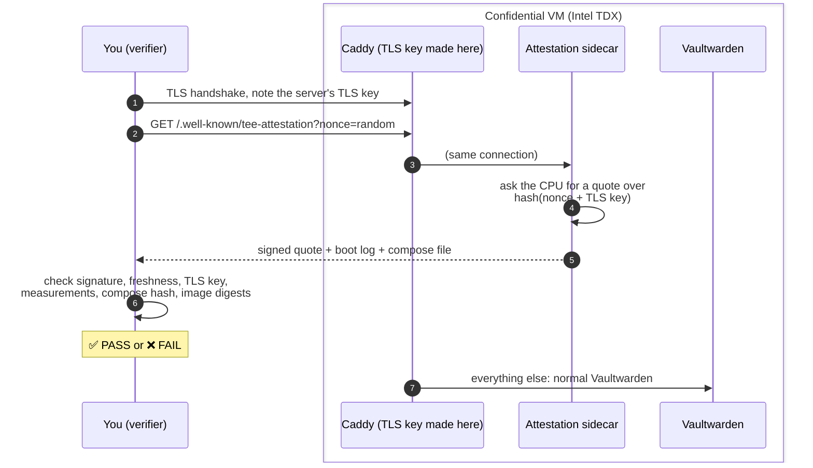

<div align="center">

# 🔐 Attested Vaultwarden

**A password manager server you don't have to take on trust.**

Run unmodified [Vaultwarden](https://github.com/dani-garcia/vaultwarden) inside a
confidential VM, and let anyone prove, from their own machine, exactly what
code is answering them.

[](https://github.com/facundomedica/attested-vaultwarden/actions/workflows/ci.yml)


[How it works](#-how-it-works) ·
[See it work](#-see-it-work) ·
[Verify a server](#-verify-a-server) ·
[What it proves](#-what-a-pass-proves-and-what-it-doesnt) ·
[Docs](#-documentation)

</div>

> [!WARNING]
> **Research prototype. Don't store real passwords on it.** It works and was
> verified live, but it has not been audited, it has one open finding
> ([below](#-known-issue)), and the live demo has been shut down (the recorded runs
> are below). The
> [threat model](docs/THREAT_MODEL.md) spells out exactly what is and isn't
> protected.

---

## 🤔 The problem

Your Bitwarden vault is encrypted on your own device, so the server never
sees your passwords. But you still trust the **server code**:

- the web vault you log into is JavaScript the server sends you, and a
  modified server can send JavaScript that steals your master password;
- researchers at ETH Zurich and USI showed
  [12 attacks a malicious Bitwarden server can mount](https://eprint.iacr.org/2026/058)
  (USENIX Security 2026): swapped organisation keys, downgraded key
  derivation, shuffled ciphertext fields…

With a self-hosted server, the only defence today is *"I trust whoever
runs it not to change the code."*

## 💡 The idea

Run the server in a **TEE** (trusted execution environment: a VM whose
memory is encrypted by the CPU, which even the cloud host can't read) and
have the hardware **sign a statement of exactly what booted**. Then anyone
can check it:

| | Question | How it's answered |
|---|---|---|
| 1️⃣ | **Is this real TEE hardware?** | Signed by Intel (or AMD/Google), debug off, firmware up to date |
| 2️⃣ | **Is it running the published release?** | Every measurement, config and container image digest matches a public release policy |
| 3️⃣ | **Am I talking to *that* VM?** | The TLS key of *your* connection is inside the signed statement, so nobody can put a different server in front of a genuine one |

The server is **stock Vaultwarden, not a fork**. Everything new is a tiny
sidecar that fetches the signed statement, and a verifier that checks it.

## 🧩 How it works



The TLS private key is generated inside the VM and lives only in its memory,
so a fresh key appears on every boot and can't be copied out. Full design:
[docs/ARCHITECTURE.md](docs/ARCHITECTURE.md).

## 🎬 See it work

Three demos, recorded live on Phala Cloud (Intel TDX) in November 2026:

| Demo | What happened | Result |
|---|---|---|
| ✅ **Honest server** | The published release, checked from a laptop | **PASS** ([transcript](demo/live/verify-2026.11.4.expected.txt)) |
| 🕵️ **Relay attack** | A proxy with its own TLS key placed in front of the real server | Hardware genuine, but TLS key doesn't match → **FAIL** ([transcript](demo/relay/relay-live.expected.txt)) |
| 🛠️ **Tamper attack** | The operator flips one setting (`SIGNUPS_ALLOWED`) and redeploys | Same hardware, same OS, but compose hash differs → **FAIL** ([transcript](demo/tamper/tamper.expected.txt)) |
| 🔄 **Restart** | VM restarted | **PASS** again, with a brand-new TLS key ([before](demo/live/verify-2026.11.4.expected.txt), [after](demo/live/verify-2026.11.4-after-restart.expected.txt)) |

What a PASS looks like (long values shortened):

```text
Platform: tdx
  ✓ TLS connection, certificate validated: TLSv1_3 … leaf SPKI SHA-256 a8ecc85c…
  ✓ Fetch attestation over same connection: same TLS connection, 26025 bytes
  ✓ TLS key bound to attestation: attested SPKI equals the certificate we received
  ✓ Freshness nonce: server echoed our fresh nonce
  ✓ Hardware evidence signature, TCB, debug off: Intel DCAP quote … TCB UpToDate, TD debug off
  ✓ report_data matches nonce + TLS key
  ✓ Firmware / OS measurements: MRTD, RTMR0-2 equal release 2026.11.4-phala-dev
  ✓ Runtime event log (RTMR3 replay): 11 events replay to the quoted RTMR3; data disk encrypted
  ✓ Compose hash (published software): 65a901cb… = release 2026.11.4-phala-dev
  ✓ Measured config: known pitfalls absent
  ✓ Images pinned and allowlisted: 3 services, all pinned by digest and allowlisted
      attest       ghcr.io/facundomedica/attest-sidecar@sha256:00055017…
      proxy        docker.io/library/caddy@sha256:003a9780…
      vaultwarden  docker.io/vaultwarden/server@sha256:4fe17f41…
Result:  PASS
```

More recorded runs: [demo/README.md](demo/README.md).

## 🔎 Verify a server

**From the command line** (Rust):

```bash
cargo run --release -p attested-vw-verify -- \
  https://vault.example.com --policy policy/<release>.toml
```

Exit code `0` means PASS; anything else is a FAIL with the failing line
marked ✗. Add `--json` for machine-readable output.

**From a browser:** `web/build.sh` produces a single HTML file that runs the
same checks in WebAssembly. A web page can't see its own TLS certificate, so
it checks the TLS key through public Certificate Transparency logs instead,
which is weaker than the CLI. Details: [web/README.md](web/README.md).

Plain-language walkthrough of every check: [docs/VERIFY.md](docs/VERIFY.md).

## 🌍 Platforms

| Platform | Status |
|---|---|
| **Phala Cloud** (Intel TDX, dstack) | 🟢 **Run live**, four releases, PASS end to end (demo VM since deleted). The main target. [Guide](docs/PHALA.md) |
| **Google Cloud Confidential Space** (Intel TDX) | 🟡 **Run live once**, PASS, and FAIL on every negative test. Trusts Google's attestation service (Google is also the host); no storage survives a restart. [Guide](docs/GCP_CONFIDENTIAL_SPACE.md) |
| **AMD SEV-SNP** (Servury Blackbox) | 🟠 **Built, never run on SNP hardware.** Reproducible guest image boot-tested in QEMU; verifier tested on AMD-signed samples. [Guide](docs/SNP.md), [Servury](docs/SNP_SERVURY.md) |
| **Self-hosted dstack** (Intel TDX) | ⚪ Runbook only. [Guide](docs/SELF_HOSTING.md) |

## 🧾 What a PASS proves, and what it doesn't

| ✅ A PASS proves | ❌ A PASS does **not** prove |
|---|---|
| Your TLS connection ends inside a genuine TEE, checked just now | That Vaultwarden itself has no bugs (attestation proves *which* code, not that it's *good*) |
| The VM booted exactly the published OS, config and image digests | That the operator never touched the **disk**: data on disk persists across releases (see below) |
| Nobody relayed the attestation in front of another server | That the Bitwarden apps check any of this; they don't, you run the verifier |
| The operator didn't change a single setting | Protection against physical attacks on the hardware |

The short version: **attestation removes the operator's ability to run
different code without being caught. It doesn't remove the operator.**

### 🚧 Known issue

Docker's image store sits on the persistent disk, and Docker trusts images
already present. An operator who once booted an unpublished setup under the
same app could alter stored image layers, and a later boot of the published
release would run them while still passing. **The fix is designed, not yet
deployed:** delete all local images at boot so each one is downloaded and
digest-checked again. Details:
[THREAT_MODEL §7](docs/THREAT_MODEL.md#7-known-issues).

<details>
<summary><b>All limitations</b></summary>

- **Persistent disk.** On Phala the disk key depends on the app, not on the
  release, so data left on disk by an earlier, unpublished setup of the same
  app is invisible to the verifier. The vault data is still end-to-end
  encrypted by the clients; the operator could read metadata, guess weak
  master passwords offline, or tamper with the database. Ways to close it are
  compared in [docs/KEEPER.md](docs/KEEPER.md).
- **The cloud's key service is trusted** to release the disk key only to
  this app; the disk has no rollback protection.
- **DNS.** Between checks, whoever controls DNS could point some clients at
  a different server. CAA records and Certificate Transparency monitoring
  narrow this ([CT and CAA checks](docs/VERIFY.md)); on the demo domain the
  CT check fails until 2027-01-31 because of old Cloudflare certificates.
- **Development releases.** Published policies accept some hardware
  configuration flags (SMT and similar), and container logs are public.
- **The sidecar image is private**, but rebuilds reproducibly from the
  commit named in each policy (`attest-sidecar/reproducible-build.sh`).
- **No external audit.** An internal review found and fixed several
  fail-open paths ([DECISIONS D-049](docs/DECISIONS.md)).

Everything, with what each item means for the claims:
[docs/THREAT_MODEL.md](docs/THREAT_MODEL.md).

</details>

## 🧪 Build and test

```bash
cargo test --workspace                   # unit tests on recorded fixtures, no network
deploy/local/e2e.sh                      # whole stack on an INSECURE mock platform (Docker)
deploy/dstack/simulator/e2e.sh           # sidecar against dstack's simulator (Docker)
web/build.sh && node web/test/run.mjs    # browser verifier and its headless test
```

No TEE needed for any of these. The mock run never prints a plain PASS: it
says `PASS (INSECURE MOCK, proves nothing)` and exits 2.

<details>
<summary><b>Repository layout</b></summary>

| Path | What |
|---|---|
| `attest-sidecar/` | Small Rust service serving `/.well-known/tee-attestation`; reproducible image build |
| `verifier/` | `attested-vw-verify` CLI and library: TDX, SEV-SNP and Confidential Space evidence, CT check |
| `common/` | Shared pieces: `report_data` construction, attestation schema, policy format, compose checks |
| `web/` | Single-file browser verifier (verifier core in WebAssembly) |
| `policy/` | Release policies: what each release must measure to PASS |
| `deploy/` | Phala/dstack, Confidential Space, SEV-SNP and an insecure local mock |
| `demo/` | Live smoke test, relay and tamper demos, CT and CAA checks, recorded outputs |
| `docs/` | Everything else, see below |
| `scripts/` | Documentation link checker |

</details>

## 📚 Documentation

| Start here | Go deeper |
|---|---|
| [**Overview and results**](docs/OVERVIEW.md): what was built, verified and left open | [Threat model](docs/THREAT_MODEL.md) |
| [**How to verify**](docs/VERIFY.md): every check in plain language | [Architecture](docs/ARCHITECTURE.md) |
| [**Deploy on Phala Cloud**](docs/PHALA.md) | [Decision log](docs/DECISIONS.md) (D-001 to D-056) |
| | [Related work](docs/RELATED_WORK.md) · [Keeper design option](docs/KEEPER.md) |

## 🤝 Security and license

Found a problem? Report it privately: [SECURITY.md](SECURITY.md).

Licensed under [MIT](LICENSE). Test fixtures copied from other projects keep
their own licenses (see `verifier/testdata/SOURCES.md`). Vaultwarden, Caddy
and the TEE platforms are their own projects under their own licenses; this
repository only references their published images.
